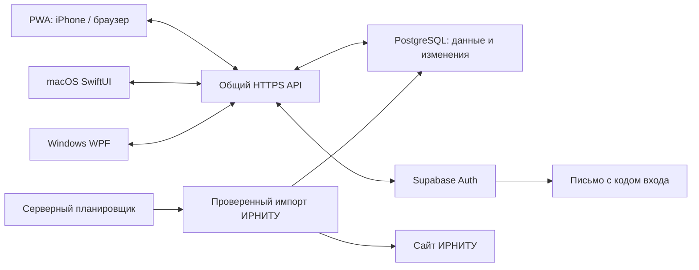

# План реализации SimpleSchedule PWA

Дата: 16 октября 2026 года. Статус: технический план и ориентир реализации. 16 октября начата разработка в `PWA/`; фактические проверки и незавершённое перечислены в `PWA/CHECKS.md` и `WORK_IN_PROGRESS.md`. Наличие кода не подтверждает настройку рабочей базы, почты или публикацию сервера.

## 1. Результат и границы работы

Создать русскоязычную PWA для iPhone и настольных браузеров с календарём, делами, пользовательскими группами и расписанием ИРНИТУ. На iPhone пользователь открывает адрес в Safari и добавляет приложение на главный экран. У PWA нет срока разработческой подписи Apple. Нативное приложение iOS, IPA, App Store и виджет iOS в этот объём **не входят**.

Сохранить поведение существующего SimpleSchedule: общая выбранная дата, месяц/неделя/день, понедельник, выделение выходных, группы и «Без группы», CRUD, выполнение, заметки, расписание и домашние задания. Интерфейс адаптировать под касания и узкий экран; на телефоне выбранный день открывать отдельным экраном/нижней панелью, недельные колонки размещать в явно прокручиваемой области. На широком экране сохранить месячную сетку и список справа. Режим расписания скрывает элементы дел и групп.

На Mac/Windows PWA может работать в браузере или отдельном установленном окне. Значки в системной строке меню/трее остаются функцией существующих нативных приложений. Их подключение к облаку — отдельный обязательный этап для синхронизации с PWA.

## 2. Предлагаемая архитектура

| Часть | Технология | Назначение |
| --- | --- | --- |
| PWA | React, TypeScript, Vite, CSS Grid | Адаптивный интерфейс и единая клиентская логика |
| Локальная база | IndexedDB через Dexie | Данные, локальные настройки, очередь изменений и курсоры синхронизации |
| Установка и офлайн | Web App Manifest, Service Worker/Workbox | Иконки, автономное окно, локальное сохранение ресурсов приложения |
| Вход | Supabase Auth, одноразовый код на email | Одна учётная запись для всех устройств |
| Облачные данные | PostgreSQL в Supabase | Изолированные данные пользователей и журнал изменений |
| API и импорт | ASP.NET Core | Обмен изменениями, проверка прав, импорт ИРНИТУ |
| Периодические задания | Серверная очередь и планировщик | Обновления независимо от включённого компьютера/открытого Safari |

ASP.NET Core позволяет повторно использовать существующий C#-парсер ИРНИТУ и его HTML fixtures из Windows-проекта. Выделить парсер и правила импорта в отдельную библиотеку, не переносить desktop StateStore на сервер целиком. Это уменьшает риск повторения исправленных ошибок чётности, подгрупп и частичных периодов.

Размещать PWA и `/api` под одним HTTPS-доменом через reverse proxy. Нужны инфраструктура HTTPS, БД, доставка почты и планировщик; их постоянная бесплатность не предполагается. Точные провайдеры и тарифы выбирать при развёртывании. Версии зависимостей закрепить lock-файлами, ресурсы интерфейса и шрифты поставлять с приложением, без сторонних CDN и аналитики.

Почта подтверждает вход. Сами дела, заметки и расписание **не пересылаются письмами**, доступ к почтовому ящику через Gmail/IMAP не запрашивается.

## 3. Вход и управление аккаунтом

1. Пользователь может начать без регистрации: данные сохраняются локально. Синхронизация выключена.
2. В настройках — «Войти и включить синхронизацию». Пользователь вводит email, получает одноразовый шестизначный код и вводит его в приложении. При первом успешном входе создаётся аккаунт, при следующих используется тот же идентификатор Supabase Auth.
3. На каждом устройстве вход выполняется с той же почтой. Владение аккаунтом определяется проверенной сессией, а не строкой email, переданной клиентом. Не придумывать собственные правила удаления точек/суффиксов адреса.
4. Настроить собственную SMTP-доставку, шаблон письма на русском, короткий срок действия кода, лимит попыток и повторной отправки. Срок и лимиты настроить в Auth и проверить интеграционными тестами; не полагаться молча на значения по умолчанию.
5. Для веб-версии использовать защищённую сессию API с HttpOnly/Secure/SameSite cookie, защитой CSRF и проверкой Origin. Токены обновления Supabase хранить на сервере защищённо; не класть их в Service Worker Cache. Для нативных клиентов — защищённое хранилище ОС и проверяемые API токены.
6. Первый вход предлагает объединить существующие локальные данные с аккаунтом. До объединения создать резервный снимок. Совпадающие записи распознавать по стабильным ID/происхождению, не по названию и не по времени на устройстве.
7. Предусмотреть выход с текущего устройства, отключение других сессий, смену почты с подтверждением и удаление аккаунта. При неотправленных правках предложить сначала синхронизировать или экспортировать их; не удалять молча.
8. Локальная база и кэш разделены по аккаунтам. Выход/вход другого пользователя не должен раскрывать предыдущие данные или отправлять ему чужую очередь. Повторный вход в свой аккаунт восстанавливает облачные данные.

Документация: [email OTP](https://supabase.com/docs/guides/auth/auth-email-passwordless), [собственная SMTP-доставка](https://supabase.com/docs/guides/auth/auth-smtp).

## 4. Общая модель данных

Ввести версионируемый сетевой контракт, независимый от macOS JSON формата 4 и Windows JSON формата 1. Даты дел хранить как гражданские даты `YYYY-MM-DD`, время занятий — минуты от начала дня. Часовой пояс устройства не должен переносить дело на соседнее число.

Основные сущности:

| Сущность | Содержание |
| --- | --- |
| Дело | UUID, название, дата, группа/null, заметка, выполнение |
| Группа дел | UUID, имя, цвет; «Без группы» — виртуальная группа |
| Ручное занятие | UUID, дата, начало/конец, предмет, вид, кабинет, преподаватель, подгруппа, ДЗ |
| Исходное расписание | Учебная группа, дата, устойчивый ID карточки и подгруппы, исходные поля, версия импорта |
| Личные правки занятия | Владелец, ссылка на исходную пару, ДЗ, переопределённые поля, скрытие/удаление |
| Настройки расписания | Институт, учебная группа, подгруппа, длительность, режим/интервал обновления |
| Данные синхронизации | Владелец, версия записи, удаление/tombstone, идентификатор операции и курсор |

Синхронизировать дела, группы, их цвета, выполнение, заметки, занятия, ДЗ и настройки расписания. Тему, положение окон/панелей, текущую выбранную дату и платформенный автозапуск оставить локальными.

Исходное расписание отделить от личных правок: обновление аудитории на сайте не удаляет ДЗ пользователя, ручная аудитория не затирается, удалённая пользователем импортированная пара не появляется снова. Стабильный ключ импорта основан на учебной группе, гражданской дате, ID источника и подгруппе; не создавать новые UUID при каждом обновлении.

## 5. Протокол синхронизации

Локальная запись и добавление операции в очередь выполняются в **одной транзакции IndexedDB**. Пользователь сразу видит результат независимо от связи.

Каждая команда содержит постоянный `operation_id`, ID устройства, тип записи, её ID, исходную ревизию/исходные значения изменяемых полей и новые значения. Для выполнения дела отправлять «установить выполнено=true/false», а не «переключить», чтобы повтор запроса не отменял действие.

Предлагаемые API:

- `POST /api/auth/request-code`, `POST /api/auth/verify-code`, `POST /api/auth/sign-out` — вход и выход;
- `GET /api/bootstrap` — согласованный снимок и начальный курсор;
- `POST /api/sync/push` — пакет идемпотентных команд и подтверждения;
- `GET /api/sync/pull?cursor=...` — страницы подтверждённых изменений;
- `POST /api/schedule/refresh` — запрос ручной актуализации;
- `GET /api/schedule/refresh-status` — состояние задания;
- API списков института/групп и настроек аккаунта.

Типовой обмен: отправить очередь → получить подтверждения/конфликты → скачать изменения после курсора → атомарно применить страницу и сохранить новый курсор. Подтверждённую команду удалять из очереди только после сохранения результата. Перезапуск, тайм-аут и повторная отправка не создают дубли.

Курсор непрозрачный для клиента и основан на порядке **подтверждённых серверных транзакций**, а не `updated_at` на телефоне. Нельзя просто выдать sequence до commit: поздняя транзакция может остаться позади уже выданного курсора. Для MVP сериализовать выпуск пользовательских ревизий под блокировкой до commit либо использовать проверенный журнал commit-позиций. Полный снимок и его курсор получать согласованно; пагинация не пропускает записи.

При истечении срока хранения журнала или смене учебной группы сервер требует полный снимок. Перед ним неотправленные локальные команды сохраняются отдельно и затем повторно согласуются; очистка базы не должна уничтожать их.

Триггеры: включение синхронизации, открытие/возврат в приложение, изменения данных, восстановление связи, ручная кнопка, завершение импорта. В открытом окне возможна редкая проверка новых ревизий. Уведомления Realtime — последующее ускорение, но не единственный источник изменений. Пропущенный сигнал всегда компенсируется чтением журнала.

Показывать статусы: «Локально», «Нет сети», «Изменений к отправке: N», «Синхронизация…», «Синхронизировано в …», «Нужно войти снова», «Конфликт требует решения».

## 6. Конфликты и целостность

- Изменения разных полей одной записи объединять. При конфликте одного поля хранить обе версии и дать выбрать; заметку/ДЗ не терять через безусловное «последний записавший победил».
- Удаления передавать tombstone. Редактирование уже удалённой записи не восстанавливает её молча; сохранить черновик конфликта и предложить отдельную копию.
- Удаление группы и перевод её дел в «Без группы» выполнять одной серверной транзакцией, отражённой в журнале. Параллельное создание дела в удалённой собственной группе обрабатывать согласованно, не допуская сломанной ссылки.
- Ошибка импорта, истёкшая сессия и ошибка почты не блокируют локальные правки. Синхронизация дел не зависит от доступности сайта вуза.
- Вход с другой почтой никогда не считается продолжением прежнего аккаунта. Для смены адреса нужен подтверждённый перенос существующего аккаунта.

## 7. Расписание: вручную или по интервалу

Настройку хранить в аккаунте, чтобы одно устройство не включало собственный независимый импорт поверх остальных. Предлагаемые варианты: «Вручную», «Автоматически» с интервалом 1/3/6 часов; набор можно расширить до начала реализации.

Для автоматического импорта предлагается скользящее окно текущего и следующего месяца. Недельные страницы внутри него объединяются без повторов. Для произвольного прошлого/будущего периода остаётся ручное обновление. Это выбранный ориентир плана, а не уже реализованное поведение.

Автоматический цикл:

1. Серверный планировщик выбирает наступившие задания, берёт lease/блокировку от параллельных исполнителей и объединяет одинаковые учебные группы/периоды.
2. Сервер загружает только разрешённые HTTPS-страницы ИРНИТУ с лимитами времени/размера и частоты. Личные дела/заметки вузу не передаются.
3. Проверенный парсер определяет активные альтернативы и все подгруппы. Подтверждённые дни сохраняются, неизвестные даты не объявляются пустыми. Ошибка или неопубликованный хвост не очищают сохранённые пары.
4. Новая исходная версия объединяется с личными правками. Публикация выбранной версии аккаунта и событий синхронизации выполняется согласованно; время последнего успеха меняется после commit.
5. Доступные клиенты получают изменения. Закрытая/офлайн PWA получает их после следующего доступного запуска. Обмен очередью дел продолжается независимо от результата импорта.

Ручная кнопка инициирует тот же процесс и синхронизацию. Совпадающие уже выполняющиеся запросы объединяются, действуют лимиты частоты. Не объявлять возврат старого кэша успешным новым парсингом без пояснения времени актуальности.

Ручной режим не инициирует автоматическое обновление расписания аккаунта. Общий серверный кэш, обновлённый для другого аккаунта, не должен сам менять его выбранную версию до ручного действия. Явное обновление на любом устройстве того же аккаунта передаётся остальным при синхронизации.

Нужен серверный планировщик, который работает при закрытых приложениях; таймер только в браузере не подходит. Возможен Supabase Cron с защищённым вызовом API и постоянной очередью либо cron/worker на выбранном хостинге. Ключ вызова задания хранить только на сервере, job API не оставлять общедоступным. Предусмотреть повтор с задержкой, восстановление просроченной lease и ограничение параллелизма.

Основа планировщика: [Supabase scheduling](https://supabase.com/docs/guides/functions/schedule-functions). На iPhone не обещать точное фоновое выполнение самой PWA раз в час или мгновенную доставку при закрытом приложении.

## 8. Работа PWA без сети и обновление версии

После первого успешного открытия по HTTPS сохранить оболочку/иконки/локальные ресурсы и базу IndexedDB. Затем доступные ранее данные, создание/правки и очередь работают без сети. Самое первое открытие без предварительной загрузки веб-ресурсов невозможно.

Service Worker кэширует только статические ресурсы. Запросы входа, приватные ответы API, коды, токены и диагностические ошибки не должны попадать в общий Cache API; для них `no-store`/NetworkOnly. Приватные данные хранятся в базе соответствующего аккаунта.

Не полагаться на постоянный фоновый процесс или поддержку Periodic Background Sync на iPhone. Все обязательные действия восстанавливаются при открытии, возврате в приложение и ручной синхронизации. Виджет iOS не нужен. Уведомления iOS/PWA добавлены пользователем как будущий этап (раздел 12); сохранение предпочтений не означает, что Web Push уже отправляется.

Проверять persistent-storage API при поддержке и честно показывать, что браузерное хранилище может быть удалено пользователем или вытеснено. Облачные данные восстанавливаются после входа; неотправленные локальные данные после такого удаления восстановить гарантированно нельзя. Предусмотреть экспорт собственных данных и предупреждение о несинхронизированной очереди перед выходом/очисткой.

Новую версию Service Worker активировать после безопасного сохранения формы/очереди. Показывать «Доступно обновление»; не перезагружать страницу во время ввода. Миграции IndexedDB и контрактов проверять на предыдущей версии, сервер временно поддерживает старые клиенты. Смена домена — отдельная миграция, поскольку локальная база привязана к origin.

Источники: [хранилище WebKit](https://webkit.org/blog/14403/updates-to-storage-policy/), [жизненный цикл Service Worker](https://developer.chrome.com/docs/workbox/service-worker-lifecycle).

## 9. Защита данных

У каждой личной записи — владелец. API определяет его из проверенной сессии, проверяет доступ к связанным группам/занятиям и не доверяет `user_id` из тела запроса. В PostgreSQL включить RLS и отдельные политики чтения/создания/изменения/удаления; для обновления проверять и существующего, и нового владельца. RPC синхронизации не должны случайно обходить правила доступа.

Служебные ключи БД/SMTP/планировщика не включать в JS, исходники публичного репозитория и Service Worker. Привилегированный импорт работает на сервере с ограниченным назначением; публичные пользовательские запросы не выполняются с неограниченным service_role.

Все соединения по HTTPS, политики CSP и разрешённых источников, вывод пользовательского текста без исполнения HTML. Диагностика не содержит текстов заметок/ДЗ, кодов входа и токенов. Регистрация и вход не требуют пароля от самой почты. Аналитика, реклама и внешние шрифты не добавляются.

Обычное облачное хранение не является сквозным шифрованием. E2EE потребует отдельного проекта управления ключами/восстановления и не включается молча в обещания первой версии.

Источник: [Supabase RLS](https://supabase.com/docs/guides/database/postgres/row-level-security).

## 10. Порядок реализации и результаты этапов

| Этап | Работа | Критерий готовности |
| --- | --- | --- |
| 1. Контракт | Общее описание данных/API, миграции, правила конфликтов и режима обновления | Один набор примеров и тестов понятен PWA/Swift/C# |
| 2. Локальная PWA | Адаптивный интерфейс, все виды, CRUD, группы, ручные занятия, темы, IndexedDB | На iPhone и desktop данные сохраняются после перезапуска |
| 3. Установка/офлайн | Manifest, иконки, Service Worker, обновление версии, очередь | После первого открытия приложение запускается без сети и сохраняет правки |
| 4. Вход | Supabase Auth, SMTP, cookie-сессии, изоляция аккаунтов | Код приходит, повторный вход открывает тот же аккаунт, чужие данные недоступны |
| 5. Синхронизация | API, журнал/курсоры, идемпотентность, конфликты, полный снимок | Два устройства обмениваются правками без потерь и дублей, в том числе после офлайна |
| 6. ИРНИТУ | Общая библиотека парсера, серверный импорт, настройки, сохранение правок | Реальные страницы совпадают с сайтом; исходные regression fixtures проходят |
| 7. Автообновление | Планировщик, очередь/lease, интервал, синхронизация после обновления | Расписание в облаке обновляется при закрытых клиентах, ручной режим не запускает автопарсинг |
| 8. macOS/Windows | Адаптеры контракта, вход, очередь, миграция/объединение существующих данных | Одно изменение проходит PWA→Mac→Windows и обратно; старые локальные базы сохранены |
| 9. Выпуск | Реальные устройства, резервное восстановление, HTTPS-развёртывание и инструкция | Пройдены сценарии ниже, доступны адрес PWA и воспроизводимая сборка |

Этапы 1–3 дают локальную устанавливаемую веб-версию. Этапы 4–7 — облачную PWA. Обещание синхронизации с существующими нативными приложениями выполнено только после этапа 8.

## 11. Проверки приёмки

1. Safari iPhone с iOS 27 и установленная PWA, Safari/Chrome/Edge на desktop; касания, экранная клавиатура, вырезы экрана, портрет/альбом, светлая/тёмная тема.
2. Первый запуск онлайн, установка на главный экран, запуск без сети после перезагрузки, создание и выполнение дела, сохранение очереди и восстановление связи.
3. Вход по одному email на двух устройствах, неверный/истёкший код, повторная отправка, истёкшая сессия, выход с неотправленными изменениями, другой аккаунт.
4. Создать/изменить/выполнить/удалить дело офлайн на обоих устройствах. Проверить повтор запроса после тайм-аута, конфликт заметки, удаление группы и отсутствие повторного появления удалённого.
5. Полная загрузка, постраничный журнал, смена группы, старый курсор, давно отключённое устройство; отсутствие пропущенных поздних commit.
6. Для 478229: 13.10.2026 две пары, 14.10 нет; активная чётность, аудитории, все подгруппы, переключение фильтра без сети, ручные пары и ДЗ после импорта.
7. Конец опубликованного периода, ошибка отдельной недели, отмена задания, повтор/параллельные импорты, недоступность сайта. Дела продолжают синхронизироваться.
8. Автоматический интервал при закрытых браузерах, ручной режим, синхронизация результата после открытия iPhone, одинаковая группа нескольких аккаунтов без лишних загрузок и смены чужой выбранной версии.
9. PWA/Swift/C# обмениваются одинаковыми UUID, гражданскими датами, минутами и удалениями. Часовой пояс и часы устройства не ломают порядок изменений.
10. Пользователь A не может получить/поменять данные B ни API-запросом, ни подменой связанного ID/курсора; RLS проверяется отдельными тестами.
11. Обновление PWA/миграция IndexedDB при открытой форме, переполнение/удаление браузерного хранилища, восстановление из облака и экспорт.
12. Секретов нет в JS/публичном Git/кэше, приватные API-ответы не кэшируются Service Worker, без аналитики и запросов к внешним ресурсам интерфейса.

В текущем запросе подготовлен только план. Эти проверки ещё не выполнялись для PWA. Текущие Windows/macOS артефакты не изменяются и не получают синхронизацию автоматически.

## 12. Будущие уведомления iOS/PWA

Пользователь добавил два вида уведомлений: изменения расписания, обнаруженные при обновлении с сайта, и напоминания перед занятиями. Виджет iOS не нужен. По умолчанию напоминание за **5 минут**, в настройках — положительное число минут (реализация предпочтений: 1–1440).

Текст: «Через 5 минут <название дисциплины>. Аудитория <…>. Преподаватель <…>. Вид занятия <…>». Для выбранного интервала подставлять правильное число минут и склонение. Время начала также хранить в payload, чтобы не показывать вводящее в заблуждение устаревшее напоминание.

Настройки аккаунта:

- общий выключатель;
- отдельно уведомления перед занятиями и об изменениях расписания;
- исключения для конкретных дисциплин (устойчивый ключ предмета/нормализованное имя, а не цвет или вид занятия);
- исключения для конкретной гражданской даты: при выборе дня в календаре «Отключить уведомления на этот день», с обратным включением;
- время напоминания в минутах, по умолчанию 5.

Все запреты складываются. Учитываются текущая учебная группа и подгруппа, общие пары остаются. Настройки синхронизируются, разрешение браузера и подписка — отдельны на каждом устройстве. Отключение офлайн действует на сервере после синхронизации; уже отправленное системное уведомление нельзя гарантированно отозвать.

Изменения сравнивать с предыдущим **исходным снимком сайта**, а не с личными правками и ДЗ. Уведомлять о добавлениях, отменах, переносах, смене предмета/вида/аудитории/преподавателя. Первый импорт задаёт базовую версию без потока уведомлений. Повтор без изменений ничего не отправляет. Неопубликованный хвост или ошибка сети — неизвестные даты, не отмена пар. Объединять изменения одной проверки в понятное сообщение и открывать нужный день при нажатии. В уведомление не включать выключенные дисциплины/даты.

Технически: серверный Web Push с VAPID, таблицей подписок и отдельной долговечной очередью напоминаний. Отбор заданий каждую минуту независим от часового импорта. При переносе/отмене пересчитать будущие задания; перед отправкой проверить актуальную версию пары и все выключатели. Дедупликация по записи/версии/типу/устройству, повтор с задержкой и ограниченным сроком доставки, удаление истёкших подписок. Не отправлять «Через 5 минут» после начала занятия. Все расчёты расписания по `Asia/Irkutsk`, не по произвольным часам телефона.

На iPhone нужны установка на главный экран и разрешение, запрошенное **по нажатию пользователя**. Только видимые уведомления, без silent push для синхронизации. Закрытая PWA не выполняет надёжный фоновый таймер; доставку ровно в выбранную минуту и без интернета обещать нельзя. Apple Developer Program для стандартного Web Push не требуется. VAPID private key хранится только на сервере; отдельный платный push-провайдер не обязателен.

Проверки будущего этапа: оба типа, каждый уровень отключения, смена минут, общие/чужие подгруппы, часовой пояс и поездка телефона, перенос/отмена, повтор импорта, временная ошибка сайта, отсутствие разрешения, два устройства, просроченная подписка, повтор/задержка отправки и офлайн-предпочтения. На реальном iPhone подтвердить доставку при закрытой установленной PWA; автоматизация WebKit этого не доказывает.

Источники: [Web Push на iOS/iPadOS](https://webkit.org/blog/13878/web-push-for-web-apps-on-ios-and-ipados/), [Declarative Web Push](https://webkit.org/blog/16535/meet-declarative-web-push/).
