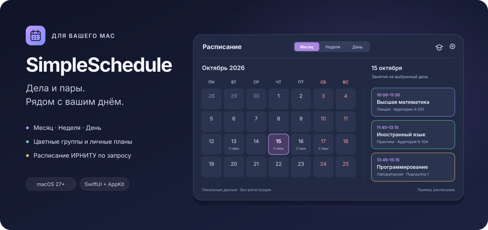

<div align="center">

# SimpleSchedule

**Личные планы и расписание университета — в строке меню macOS.**

Swift · SwiftUI · AppKit · macOS 27+ · Интерфейс на русском

[Скачать](#скачать) · [Установка](#установка) · [Как пользоваться](#как-пользоваться) · [Сборка из исходников](#для-разработчиков)



<sub>Иллюстрация возможностей. Оформление приложения следует настройкам вашего Mac.</sub>

</div>

SimpleSchedule помогает видеть, что запланировано на день: личные дела с цветными группами и университетские пары с временем, аудиторией, преподавателем и домашним заданием. Нажмите значок календаря в верхней строке меню — и нужная информация перед вами.

В приложении два режима: **дела** и **расписание**. В каждом доступны месяц, неделя и день с общей выбранной датой. Данные сохраняются на Mac; для обычной работы интернет и учётная запись не нужны.

## Возможности

| Личные дела | Расписание университета |
| :--- | :--- |
| Месяц с цветными метками, неделя в семь колонок, подробный день | Количество пар и время в месяце, карточки занятий в неделе и дне |
| Группы с названиями и собственными цветами, раздел «Без группы» | Ручное добавление и редактирование занятий |
| Выполнение, заметки, перенос на другую дату | Импорт с официального сайта ИРНИТУ по нажатию кнопки |
| Все дела группы на отдельной странице | Выбор института, академической группы и подгруппы |

- **Быстрый доступ.** Повторный клик по значку скрывает панель. При переходе между рабочими столами открытая панель остаётся доступна.
- **Понятные карточки.** Лабораторные работы выделены жёлто-оранжевой линией, практика — зелёной, остальные занятия — синей. Вид занятия также указан текстом.
- **Нативное оформление.** Размытие фона, светлая и тёмная темы, системный акцент и настройка прозрачности. Учитываются системные настройки уменьшения прозрачности и движения.
- **Сохранение на устройстве.** Дела, группы, занятия и настройки хранятся локально. Есть автозапуск через штатный механизм macOS.

## Скачать

Требуется **macOS 27 или новее**. Выберите сборку для процессора вашего Mac:

| Процессор | Установочный образ |
| :--- | :--- |
| Apple Silicon — чипы Apple M-серии (`arm64`) | [Скачать для Apple Silicon](https://github.com/pouqwyggad1/SimpleSchedule/releases/download/v1.0.0/SimpleSchedule-1.0.0-AppleSilicon.dmg) |
| Intel (`x86_64`), если Mac поддерживает macOS 27 | [Скачать для Intel](https://github.com/pouqwyggad1/SimpleSchedule/releases/download/v1.0.0/SimpleSchedule-1.0.0-Intel.dmg) |

[Все релизы](https://github.com/pouqwyggad1/SimpleSchedule/releases) · [Контрольные суммы SHA-256](https://github.com/pouqwyggad1/SimpleSchedule/releases/download/v1.0.0/SHA256SUMS.txt)

Тип процессора указан в меню ** → Об этом Mac**. Сборка Intel скомпилирована и проверена статически; запуск на физическом Intel Mac пока не проверен. Подробности проверки поставки — в [отчёте релиза](Docs/RELEASE_CHECKS.md).

## Установка

1. Скачайте подходящий DMG и откройте его.
2. Перетащите **SimpleSchedule.app** на значок **Программы / Applications** внутри образа.
3. Извлеките образ и откройте **SimpleSchedule** из папки «Программы».
4. Нажмите значок календаря в строке меню macOS. Приложение работает оттуда; отдельного значка в Dock нет.

> **Подпись первой версии.** Эти сборки имеют локальную подпись ad hoc, без сертификата Developer ID и нотариального заверения Apple. Поэтому при первом запуске Gatekeeper может их заблокировать. Если вы доверяете этому источнику, после первой попытки запуска откройте **Системные настройки → Конфиденциальность и безопасность → Всё равно открыть**, если такая кнопка доступна, и подтвердите запуск. Подробнее — [официальная инструкция Apple](https://support.apple.com/ru-ru/102445). Если система сообщает о повреждении или вредоносном ПО, не обходите это предупреждение.

При первом запуске приложение запрашивает регистрацию собственного автозапуска. Если macOS требует подтверждения, его состояние появится в настройках приложения. Автозапуск можно отключить там же. Сначала переместите приложение в постоянную папку «Программы», затем настраивайте его запуск при входе.

## Как пользоваться

### Начать с личных дел

1. Откройте панель значком в строке меню. Выберите **Месяц**, **Неделя** или **День**.
2. Нажмите **+ Добавить**, укажите название и дату. При желании добавьте группу и заметку. Новую группу можно создать прямо в этой форме.
3. Отмечайте выполненное кружком слева. Выполненные дела перемещаются вниз. Нажатие на название открывает редактирование, меню **…** — дополнительные действия и удаление с подтверждением.
4. Нажмите цветную кнопку группы, чтобы увидеть её дела за все даты. Повторное нажатие вернёт прежний вид календаря. Группы, которым не хватило места, доступны в меню **+N**.

В месяце дела выбранного дня появляются справа. В неделе кнопка **+** под колонкой создаёт дело на дату этой колонки. **Группы** слева от поля даты открывает управление названиями и цветами. Удаление группы сохраняет её дела в разделе **Без группы**.

### Подключить расписание ИРНИТУ

1. Нажмите кнопку с академической шапочкой рядом с настройками. Панель переключится на **Расписание**.
2. Откройте **Настройки → Расписание ИРНИТУ** и нажмите **Загрузить институты**. Выберите институт — приложение загрузит его академические группы.
3. Выберите свою группу и длительность пары. По умолчанию окончание рассчитывается как начало плюс **90 минут**.
4. Закройте настройки, выберите нужный период и нажмите **Обновить расписание** слева от переключателя видов.
5. Вернитесь в настройки и выберите **Подгруппу**. Доступные номера берутся с сайта после импорта. Для выбранного номера показываются общие пары и пары этой подгруппы; **Все подгруппы** показывает все активные занятия.

Все подгруппы импортируются сразу. После загрузки можно менять подгруппу без интернета — календарь сразу перестроится по сохранённым данным. В месячном виде обновляются недели видимой сетки; в недельном и дневном — неделя выбранной даты. Если расписание опубликовано лишь частично, приложение сохраняет подтверждённые дни, а неизвестные дни оставляет без изменений.

Кнопка **+ Занятие** добавляет пару вручную. Время окончания подставляется автоматически, его можно исправить. Нажмите карточку, чтобы изменить занятие или записать домашнее задание. Импорт сохраняет ручные занятия, домашние задания и внесённые вами правки. Повторное нажатие **Обновить расписание** во время загрузки отменяет её.

Импорт использует [официальный сайт ИРНИТУ](https://www.istu.edu/raspisanie). Изменения разметки сайта могут потребовать обновления парсера. Приложение не является официальным продуктом университета.

### Даты, оформление и завершение

- **Стрелки** перелистывают месяц, неделю или день в зависимости от выбранного вида. **Сегодня** возвращает к текущему дню.
- **Поле даты** позволяет изменить день, месяц и год. Кнопка календаря рядом открывает переход к точной дате. Смена вида или режима сохраняет выбранную дату.
- **Шестерёнка → Настройки**: тема, прозрачность фона, длительность пары и автозапуск.
- **Повторный клик по значку** скрывает панель. Чтобы завершить процесс, выберите **Завершить приложение** в меню шестерёнки или в меню правого клика по значку.

## Данные и доступ к сети

Личные данные сохраняются в собственном контейнере приложения. Встроенное хранилище использует атомарную запись и резервную копию предыдущего состояния. Нет регистрации, облачной синхронизации, аналитики, рекламы и автоматической проверки обновлений.

Основное приложение работает в **App Sandbox без сетевых разрешений**. Для импорта предусмотрена отдельная встроенная XPC-служба с разрешением на исходящую сеть. Она обращается только к страницам расписания `www.istu.edu` по вашему действию: загрузке списков, выбору института или нажатию кнопки обновления. Одна операция обновления может загрузить несколько недель. Фонового опроса сайта нет; сохранённые данные доступны без сети.

Разрешение службы является постоянным разрешением sandbox; ограничения адреса и момента обращения реализованы кодом. Это не временное разрешение macOS, включаемое кнопкой. Приложение не требует Accessibility, записи экрана или полного доступа к диску.

## Для разработчиков

Проект написан на **Swift 6, SwiftUI и AppKit** с публичными API Apple. Нет Electron, веб-оболочки или внешних пакетных зависимостей.

```sh
git clone https://github.com/pouqwyggad1/SimpleSchedule.git
cd SimpleSchedule
./scripts/build-offline.sh       # локальная сборка для текущей архитектуры
./scripts/test.sh                # изолированные проверки
```

Локальный результат — `build/Calendar.app`. Для сборки в Xcode откройте [Calendar.xcodeproj](Calendar.xcodeproj), выберите схему **Calendar** и настройте подпись своей Team.

- [Подробная инструкция по сборке и архитектуре](Docs/Сборка.md)
- [Проверки релиза и ограничения](Docs/RELEASE_CHECKS.md)
- [Сценарии ручной проверки](Docs/Ручная%20проверка.md)

**Виджет рабочего стола есть в исходном Xcode-проекте, но не включён в DMG этого релиза.** Его установка требует полного Xcode, подписи Team с App Groups и отдельной проверки WidgetKit; локальная компиляция расширения не подтверждает работу установленного виджета.

Нашли ошибку или хотите предложить улучшение? [Создайте issue](https://github.com/pouqwyggad1/SimpleSchedule/issues), указав версию macOS, архитектуру и шаги воспроизведения. Не прикладывайте личные дела, заметки или файлы своей базы.
